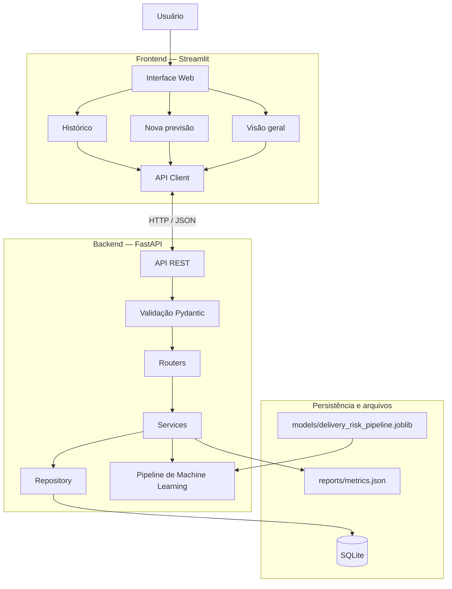
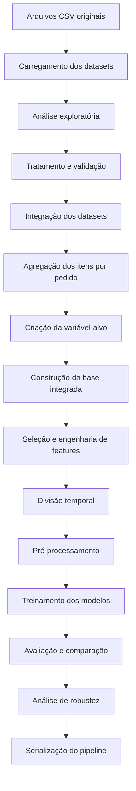
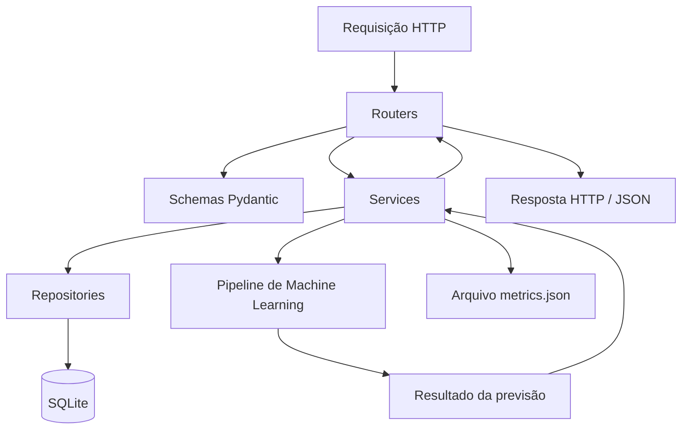
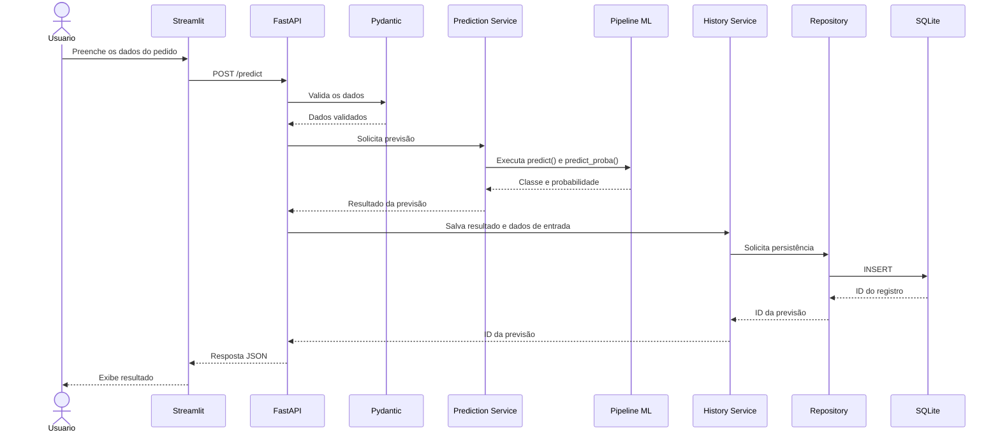

# Arquitetura do Sistema — DeliveryRisk AI

## 1. Visão geral

O **DeliveryRisk AI** é um sistema de Machine Learning desenvolvido para estimar o risco de atraso na entrega de pedidos de e-commerce brasileiro.

A arquitetura foi organizada em quatro partes principais:

1. **Pipeline de Machine Learning:** responsável pelo carregamento, tratamento, integração, análise e preparação dos dados, treinamento e avaliação dos modelos.
2. **Backend (FastAPI):** responsável por disponibilizar o modelo por meio de uma API REST, validar os dados recebidos, executar previsões e gerenciar o histórico.
3. **Banco de dados (SQLite):** responsável pelo armazenamento persistente do histórico de previsões.
4. **Frontend (Streamlit):** responsável pela interação com o usuário, permitindo consultar métricas, realizar previsões e visualizar o histórico.

A comunicação entre o frontend e o backend ocorre por meio de requisições HTTP. O frontend não acessa diretamente o modelo de Machine Learning nem o banco de dados.

## 2. Visão arquitetural

A arquitetura geral do sistema pode ser representada pelo seguinte fluxo:



O frontend realiza as solicitações por meio do `APIClient`, enquanto o backend concentra as regras de negócio, o acesso ao modelo e a persistência dos resultados.

## 3. Arquitetura do pipeline de Machine Learning

O pipeline está localizado no diretório `pipeline/` e possui módulos independentes para cada etapa do processamento.

### 3.1. Fluxo de processamento dos dados

O processo começa com os arquivos CSV do Brazilian E-Commerce Public Dataset by Olist.

São utilizados cinco conjuntos de dados:

- `olist_orders_dataset.csv`
- `olist_order_items_dataset.csv`
- `olist_customers_dataset.csv`
- `olist_products_dataset.csv`
- `olist_sellers_dataset.csv`

O fluxo de processamento é organizado nas seguintes etapas:



### 3.2. Responsabilidades dos módulos

Os módulos localizados em `pipeline/src/` possuem as seguintes responsabilidades:

| Módulo | Responsabilidade |
|---|---|
| `carregamento.py` | Carregamento dos arquivos CSV. |
| `analise_exploratoria.py` | Inspeção, análise estatística e visualização dos dados. |
| `tratamento.py` | Validação de colunas, chaves, tipos e valores dos datasets. |
| `integracao_dados.py` | Agregação dos itens e integração dos conjuntos de dados ao nível do pedido. |
| `feature_engineering.py` | Seleção de features, criação de atributos temporais e pré-processamento. |
| `preparacao_modelo.py` | Divisão temporal dos dados e validação dos conjuntos. |
| `modelos.py` | Configuração, criação e treinamento dos modelos. |
| `avaliacao.py` | Cálculo de métricas, comparação de experimentos e análise de resultados. |
| `robustez.py` | Avaliação da generalização, análise temporal e serialização do pipeline. |

O notebook `pipeline/notebooks/delivery_risk_analysis.ipynb` reúne a execução e a análise das etapas experimentais.

### 3.3. Construção da variável-alvo

A variável-alvo utilizada pelo modelo é `delivery_delayed`.

Sua construção considera a comparação entre a data real de entrega e a data estimada:

- `1`: entrega realizada após a data estimada.
- `0`: entrega realizada até a data estimada.
- `NaN`: pedido sem informações suficientes para determinar o resultado.

Somente pedidos com as duas datas disponíveis são considerados elegíveis para a classificação.

### 3.4. Prevenção de vazamento de dados

Para evitar data leakage, são excluídas da seleção de features informações que não estariam disponíveis no momento da compra.

Entre as colunas excluídas estão:

- Identificadores dos pedidos e clientes.
- Data real de entrega.
- Data de entrega ao transportador.
- Status do pedido.
- Data estimada de entrega.
- Variável-alvo e atributos auxiliares.
- Data original da compra, após a criação dos atributos temporais.

Os atributos utilizados são construídos com informações disponíveis no contexto da compra.

### 3.5. Pré-processamento e treinamento

O pré-processamento é realizado utilizando recursos do Scikit-learn.

Para as variáveis numéricas:
- Imputação de valores ausentes pela mediana.
- Padronização com `StandardScaler`, quando configurada.

Para as variáveis categóricas:
- Imputação pela categoria mais frequente.
- Codificação com `OneHotEncoder`, utilizando `handle_unknown="ignore"`.

A divisão dos dados é temporal, respeitando a ordem cronológica das compras:

| Conjunto | Período |
|---|---|
| Treinamento | Até 28/02/2018 |
| Validação | 01/03/2018 a 31/05/2018 |
| Teste | 01/06/2018 a 31/08/2018 |

O modelo selecionado foi o Random Forest, experimento 4, com os seguintes hiperparâmetros:

- `n_estimators=100`
- `max_depth=10`
- `class_weight="balanced"`

O critério de seleção foi o maior F1-score na validação.

### 3.6. Artefatos gerados

Os principais artefatos utilizados e gerados pelo pipeline são:

| Caminho | Finalidade |
|---|---|
| `data/processed/base_integrada.parquet` | Base integrada ao nível do pedido. |
| `models/delivery_risk_pipeline.joblib` | Pipeline de Machine Learning serializado. |
| `reports/metrics.json` | Relatório de métricas e avaliação do modelo. |
| `reports/metrics/` | Relatórios tabulares de comparação e desempenho dos experimentos. |
| `images/` | Gráficos e visualizações produzidos durante as análises. |

O arquivo `.joblib` contém o pipeline necessário para realizar previsões com os dados de entrada.

## 4. Arquitetura do backend

O backend foi desenvolvido com FastAPI e organizado em camadas para separar as responsabilidades da aplicação.

A estrutura está localizada em `backend/`.

### 4.1. Camadas da aplicação



As camadas possuem as seguintes responsabilidades:

#### Routers

Localizados em `backend/routers/`, recebem as requisições HTTP e direcionam as operações para os serviços correspondentes.

Arquivos:

- `health.py`
- `predictions.py`
- `history.py`
- `metrics.py`

#### Schemas

O arquivo `backend/schemas.py` contém os modelos Pydantic utilizados para validar e estruturar os dados de entrada e saída da API.

A validação contempla:

- Tipos de dados.
- Campos obrigatórios.
- Limites numéricos.
- Restrições de valores.
- Campos extras não permitidos.
- Estrutura das respostas.

O schema `PredictionInput` utiliza validação estrita e não permite campos adicionais.

#### Services

Localizados em `backend/services/`, concentram as regras de negócio.

| Serviço | Responsabilidade |
|---|---|
| `prediction_service.py` | Preparar os dados de entrada e executar a previsão. |
| `history_service.py` | Coordenar as operações do histórico de previsões. |
| `metrics_service.py` | Carregar as métricas registradas em JSON. |

#### Repositories

O diretório `backend/repositories/` contém a camada responsável pelo acesso e pela persistência dos dados.

O arquivo `prediction_repository.py` realiza operações de:

- Inserção de previsões.
- Consulta do histórico.
- Consulta de previsão por identificador.
- Exclusão de registros.

#### Database

O diretório `backend/database/` concentra a configuração da conexão SQLite e a criação da tabela de histórico.

Arquivos:

- `connection.py`: criação e gerenciamento das conexões.
- `models.py`: criação da tabela `predictions`.

#### Core

O diretório `backend/core/` reúne funcionalidades transversais da aplicação.

- `logging_config.py`: configuração dos registros da aplicação.
- `exception_handlers.py`: tratamento centralizado de exceções HTTP, erros de validação e exceções gerais.

### 4.2. Inicialização da API e carregamento do modelo

O arquivo `backend/main.py` é responsável pela criação da aplicação FastAPI.

A inicialização utiliza o mecanismo `lifespan` para executar as seguintes operações:

1. Configurar e iniciar os registros da aplicação.
2. Criar a tabela de histórico no SQLite.
3. Verificar a existência do arquivo do pipeline.
4. Carregar o pipeline serializado utilizando Joblib.
5. Armazenar o pipeline em `app.state.pipeline`.
6. Disponibilizar a aplicação para receber requisições.

O modelo é carregado uma única vez durante a inicialização da API, evitando que o arquivo seja carregado novamente a cada previsão.

A dependência `get_pipeline`, definida em `backend/dependencies.py`, recupera o pipeline armazenado no estado da aplicação.

No encerramento, o pipeline é removido do estado da aplicação.

### 4.3. Endpoints da API

A API disponibiliza os seguintes endpoints:

| Método | Endpoint | Responsabilidade |
|---|---|---|
| GET | `/health` | Verificar a disponibilidade da API e do pipeline. |
| POST | `/predict` | Realizar uma previsão e salvar o resultado no histórico. |
| GET | `/predictions` | Consultar o histórico de previsões. |
| GET | `/predictions/{id}` | Consultar uma previsão específica. |
| DELETE | `/predictions/{id}` | Excluir uma previsão do histórico. |
| GET | `/metrics` | Consultar as métricas de avaliação do modelo. |

A documentação interativa dos endpoints é disponibilizada pelo Swagger UI em `/docs`.

### 4.4. Fluxo de uma previsão

Quando o usuário solicita uma nova previsão, ocorre o seguinte fluxo:



O resultado contém:

- Identificador da previsão.
- Classe prevista.
- Descrição textual da classificação.
- Probabilidade estimada de atraso.
- Mensagem de confirmação.

A classe `0` representa ausência de atraso previsto, enquanto a classe `1` representa atraso previsto.

A probabilidade retornada corresponde à estimativa do modelo para a classe de atraso.

## 5. Banco de dados e persistência

O sistema utiliza SQLite para armazenar o histórico das previsões.

O banco de dados está localizado em:

`data/delivery_risk.db`

A tabela utilizada é `predictions`.

### 5.1. Estrutura da tabela

| Campo | Tipo | Descrição |
|---|---|---|
| `id` | INTEGER | Identificador único da previsão. |
| `prediction` | INTEGER | Classe prevista: 0 ou 1. |
| `prediction_label` | TEXT | Descrição textual da classificação. |
| `delay_probability` | REAL | Probabilidade estimada de atraso. |
| `input_data` | TEXT | Dados utilizados na previsão, armazenados em JSON. |
| `created_at` | TEXT | Data e horário de criação do registro. |

A tabela possui restrições para garantir que a classe prevista esteja entre `0` e `1` e que a probabilidade esteja no intervalo de `0` a `1`.

A persistência é realizada exclusivamente pelo backend. O frontend não possui acesso direto ao banco de dados.

## 6. Arquitetura do frontend

O frontend foi desenvolvido utilizando Streamlit e está localizado no diretório `frontend/`.

Sua responsabilidade é apresentar as funcionalidades do sistema e permitir a interação do usuário com a API.

### 6.1. Organização

| Diretório ou arquivo | Responsabilidade |
|---|---|
| `streamlit_app.py` | Configuração geral, estilização e navegação. |
| `config.py` | Configurações da interface e endereço da API. |
| `api_client.py` | Comunicação HTTP com o backend. |
| `pages/` | Implementação das páginas da aplicação. |
| `components/` | Componentes reutilizáveis da interface. |
| `utils/` | Funções auxiliares de formatação e validação. |

### 6.2. Páginas

O frontend possui três páginas principais:

**Visão geral (`visao_Geral.py`)**

Apresenta informações gerais do sistema e indicadores relacionados às previsões e às métricas do modelo.

**Nova previsão (`nova_Previsao.py`)**

Disponibiliza o formulário para preenchimento dos atributos de um pedido e solicitação de uma nova previsão.

**Histórico (`historico.py`)**

Permite consultar as previsões registradas, visualizar seus detalhes e excluir registros.

### 6.3. Comunicação com a API

O arquivo `frontend/api_client.py` centraliza as requisições HTTP realizadas pelo frontend.

A classe `APIClient` disponibiliza métodos correspondentes aos endpoints da API.

A comunicação utiliza JSON e possui timeout de 10 segundos por requisição.

O cliente também trata situações como:

- Timeout.
- Falha de conexão.
- Erros de requisição HTTP.
- Respostas HTTP com erro.
- JSON inválido.
- Respostas sem conteúdo HTTP 204.

Os erros de comunicação são encapsulados na exceção `APIClientError`, permitindo que as páginas apresentem mensagens apropriadas ao usuário.

O endereço da API pode ser configurado pela variável de ambiente `DELIVERYRISK_API_URL`. Caso ela não esteja definida, é utilizado `http://127.0.0.1:8000`.

## 7. Fluxo de comunicação entre os componentes

O fluxo geral de utilização do sistema é:

1. O usuário acessa a aplicação Streamlit.
2. O frontend realiza uma verificação de disponibilidade da API.
3. O usuário consulta as métricas ou informa os dados de um pedido.
4. O `APIClient` envia uma requisição HTTP para a API.
5. O FastAPI valida os dados recebidos por meio dos schemas Pydantic.
6. O serviço correspondente executa a operação solicitada.
7. Quando necessário, o backend utiliza o pipeline de Machine Learning ou consulta o SQLite.
8. O backend retorna os dados em formato JSON.
9. O frontend processa e apresenta o resultado ao usuário.

Essa organização mantém as responsabilidades separadas e evita o acoplamento direto entre a interface, o modelo e o banco de dados.

## 8. Logging e tratamento de erros

O sistema possui mecanismos centralizados de registro e tratamento de erros.

### 8.1. Logging

A configuração está implementada em `backend/core/logging_config.py`.

Os registros são direcionados para:

- Console, com formatação colorida.
- Arquivo `logs/delivery_risk.log`.

O arquivo utiliza `RotatingFileHandler`, com limite de 10 MB por arquivo e até 30 arquivos de backup.

Os níveis de log utilizados incluem DEBUG, INFO, WARNING, ERROR e CRITICAL.

### 8.2. Tratamento de exceções

O arquivo `backend/core/exception_handlers.py` centraliza o tratamento de:

- Exceções HTTP.
- Erros de validação das requisições.
- Exceções gerais não tratadas.

As respostas de erro são estruturadas para facilitar a identificação dos problemas durante a utilização da API.

## 9. Arquitetura de testes

O projeto utiliza Pytest para executar testes automatizados.

A estrutura está organizada em testes de backend e frontend, separados entre testes unitários e de integração.

```text
tests/
├── tests_backend/
│   ├── integration/
│   │   ├── test_health.py
│   │   ├── test_history.py
│   │   ├── test_metrics.py
│   │   └── test_predictions.py
│   │
│   └── unit/
│       ├── test_metrics_service.py
│       ├── test_prediction_repository.py
│       ├── test_prediction_service.py
│       └── test_schemas.py
│
└── tests_frontend/
    ├── integration/
    │   ├── test_api_integration.py
    │   └── test_frontend_pages.py
    │
    └── unit/
        ├── test_api_client.py
        ├── test_formatters.py
        └── test_validators.py
```

### 9.1. Testes unitários

Verificam o comportamento isolado das funcionalidades, incluindo:

- Validação dos schemas.
- Regras dos serviços.
- Operações do repositório.
- Tratamento de erros do cliente HTTP.
- Formatação de dados.
- Validação dos campos da interface.

### 9.2. Testes de integração

Verificam a interação entre componentes, incluindo:

- Endpoints da API.
- Comunicação HTTP.
- Operações do histórico.
- Consulta de métricas.
- Comportamento das páginas Streamlit.

A execução completa é realizada pelo comando:

```bash
python -m pytest tests/ -v
```

Na execução registrada durante o desenvolvimento, foram aprovados 91 testes automatizados.

## 10. Tecnologias utilizadas

| Camada | Tecnologias |
|---|---|
| Linguagem | Python |
| Manipulação de dados | Pandas e NumPy |
| Machine Learning | Scikit-learn |
| Serialização | Joblib |
| Visualização | Matplotlib, Seaborn e Plotly |
| Experimentação | Jupyter Notebook |
| Backend | FastAPI e Uvicorn |
| Validação | Pydantic |
| Persistência | SQLite |
| Frontend | Streamlit |
| Comunicação HTTP | Requests |
| Logging | Logging e Colorlog |
| Testes | Pytest e HTTPX |

## 11. Decisões arquiteturais

As principais decisões adotadas no desenvolvimento foram:

**Separação de responsabilidades**

O pipeline de Machine Learning, o backend, o banco de dados e o frontend possuem responsabilidades distintas.

**API como camada de comunicação**

O frontend acessa as funcionalidades do sistema exclusivamente por meio da API REST.

**Carregamento único do modelo**

O pipeline serializado é carregado durante a inicialização da API e mantido no estado da aplicação.

**Separação entre serviços e persistência**

As regras de negócio ficam nos serviços, enquanto as operações de banco de dados ficam no repositório.

**Validação dos dados**

Os schemas Pydantic garantem a validação dos dados recebidos pela API antes da execução das operações.

**Persistência do histórico**

As previsões são armazenadas no SQLite, permitindo consultas posteriores pela interface.

**Configuração centralizada de comunicação**

O endereço da API é configurável por variável de ambiente, sem necessidade de alterar o código das páginas.

## 12. Limitações e considerações

O DeliveryRisk AI é um projeto acadêmico desenvolvido para demonstrar a construção de uma solução de Machine Learning integrada a uma aplicação web.

O modelo possui limitações de generalização identificadas durante a avaliação temporal, especialmente no conjunto de teste.

Por esse motivo, as previsões devem ser interpretadas como estimativas experimentais, e não como garantias de ocorrência de atraso.

A arquitetura implementada atende ao escopo acadêmico do projeto e não representa uma infraestrutura preparada ou homologada para operação em produção.

## 13. Resumo da arquitetura

O DeliveryRisk AI utiliza uma arquitetura em camadas, na qual:

- O pipeline processa os dados e disponibiliza o modelo treinado.
- O backend FastAPI valida as entradas, executa previsões e gerencia as operações.
- O SQLite armazena o histórico das previsões.
- O frontend Streamlit permite a interação com o sistema por meio de requisições HTTP.
- O Pytest verifica o comportamento dos componentes e a integração entre eles.

Essa organização permite manter o projeto modular, facilitar a manutenção do código e separar as responsabilidades de processamento, comunicação, persistência e apresentação.