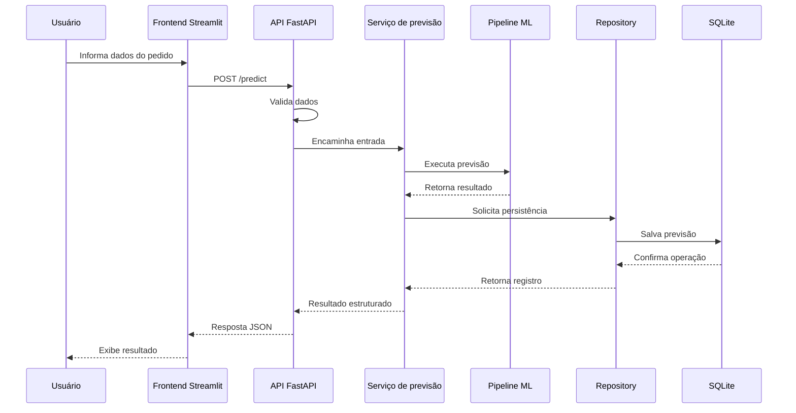

# Backend Specification — DeliveryRisk AI

## 1. Visão geral

Este documento apresenta a especificação técnica do backend do projeto **DeliveryRisk AI**.

O backend foi desenvolvido utilizando **FastAPI** e é responsável por disponibilizar os recursos necessários para integração entre o modelo de Machine Learning, a persistência dos resultados e o frontend desenvolvido em Streamlit.

A API recebe os dados de um pedido, valida as informações, executa a previsão utilizando o pipeline treinado e disponibiliza o resultado para consulta.

A aplicação possui arquitetura modular, organizada em camadas, com responsabilidades separadas para facilitar a manutenção, os testes e a compreensão do código.

O projeto possui finalidade acadêmica e experimental, não sendo destinado atualmente à utilização em produção.

## 2. Tecnologias utilizadas

| Tecnologia | Finalidade |
|---|---|
| Python | Linguagem de programação |
| FastAPI | Desenvolvimento da API REST |
| Pydantic | Validação e estruturação dos dados |
| Uvicorn | Servidor ASGI |
| SQLite | Persistência do histórico de previsões |
| Joblib | Carregamento do pipeline de Machine Learning |
| Scikit-learn | Execução do modelo |
| Pytest | Testes automatizados |
| Logging | Registro de eventos e erros |

## 3. Arquitetura do backend

O backend segue uma arquitetura modular em camadas, evitando concentrar todas as responsabilidades em um único arquivo.

As principais camadas são:

- **Routers:** recebem as requisições HTTP e direcionam as operações.
- **Schemas:** definem os modelos de entrada e saída e validam os dados.
- **Services:** concentram as regras de negócio e a lógica de aplicação.
- **Repositories:** realizam as operações de persistência.
- **Database:** gerencia a conexão e a estrutura do banco de dados.
- **Core:** reúne configurações e recursos compartilhados da aplicação.

### 3.1 Estrutura de diretórios

```text
backend/
├── main.py
├── core/
│   ├── config.py
│   └── logging_config.py
├── database/
│   ├── connection.py
│   └── ...
├── routers/
│   ├── health.py
│   ├── predictions.py
│   └── metrics.py
├── schemas/
│   ├── ...
├── services/
│   ├── ...
└── repositories/
    ├── ...
```

## 4. Inicialização da aplicação

O arquivo `backend/main.py` é o ponto de entrada da API.

Ele é responsável por:

- Criar a aplicação FastAPI.
- Configurar o ciclo de vida da aplicação.
- Inicializar os recursos necessários.
- Carregar o pipeline de Machine Learning.
- Disponibilizar o pipeline no estado da aplicação.
- Registrar os routers.
- Configurar os manipuladores de exceções.
- Preparar a documentação automática da API.

### 4.1 Ciclo de vida da aplicação

O pipeline de Machine Learning é carregado durante a inicialização da aplicação, utilizando o mecanismo de lifespan do FastAPI.

Após o carregamento, o objeto fica disponível em:

`app.state.pipeline`

Essa abordagem evita carregar novamente o arquivo do modelo a cada requisição.

O pipeline utilizado é:

`models/delivery_risk_pipeline.joblib`

## 5. Endpoints da API

A API disponibiliza seis endpoints principais.

| Método | Endpoint | Descrição |
|---|---|---|
| GET | `/health` | Verifica a disponibilidade da API e do modelo |
| POST | `/predict` | Realiza uma nova previsão |
| GET | `/predictions` | Lista o histórico de previsões |
| GET | `/predictions/{id}` | Consulta uma previsão específica |
| DELETE | `/predictions/{id}` | Exclui uma previsão do histórico |
| GET | `/metrics` | Disponibiliza as métricas do modelo |

### 5.1 GET /health

Verifica o estado da aplicação.

**Objetivo:**

Permitir que o frontend ou outro cliente verifique se a API está respondendo e se o modelo foi carregado corretamente.

**Resposta esperada:**

Um objeto JSON contendo informações de estado da aplicação.

O formato exato da resposta deve seguir o schema implementado no projeto.

### 5.2 POST /predict

Realiza uma previsão de risco de atraso para um pedido.

**Objetivo:**

Receber os dados de entrada, validar as informações e executar o pipeline de Machine Learning.

**Fluxo:**

1. Recebe os dados em JSON.
2. Valida a estrutura e os tipos utilizando Pydantic.
3. Encaminha os dados ao serviço de previsão.
4. Executa o pipeline de Machine Learning.
5. Organiza o resultado da previsão.
6. Persiste o resultado no banco SQLite.
7. Retorna a resposta ao cliente.

**Exemplo ilustrativo de requisição:**

```json
{
  "order_item_count": 2,
  "total_price": 150.0,
  "freight_value": 20.0
}
```

Os campos acima são apenas ilustrativos. A requisição real deve conter todas as features exigidas pelo schema de entrada implementado no projeto.

### 5.3 GET /predictions

Retorna o histórico de previsões armazenadas.

**Objetivo:**

Permitir a consulta das previsões realizadas anteriormente.

O endpoint é utilizado pela página de histórico do frontend.

### 5.4 GET /predictions/{id}

Consulta uma previsão específica utilizando seu identificador.

**Objetivo:**

Recuperar os detalhes de uma previsão previamente armazenada.

Caso o identificador não corresponda a um registro existente, a API deve retornar o erro HTTP apropriado.

### 5.5 DELETE /predictions/{id}

Remove uma previsão do histórico.

**Objetivo:**

Permitir a exclusão de registros armazenados no banco SQLite.

A operação não modifica o pipeline de Machine Learning nem os dados utilizados no treinamento.

### 5.6 GET /metrics

Disponibiliza as métricas registradas para o modelo.

**Objetivo:**

Permitir que o frontend apresente informações sobre o desempenho do modelo.

Os dados são obtidos do artefato:

`reports/metrics.json`

## 6. Schemas e validação

A camada `schemas/` utiliza Pydantic para definir os contratos de entrada e saída da API.

A validação ocorre antes da execução das regras de negócio.

Essa camada é responsável por:

- Definir os campos esperados.
- Validar os tipos de dados.
- Verificar restrições dos campos.
- Impedir a entrada de dados incompatíveis com o contrato.
- Padronizar as respostas da aplicação.

### 6.1 Schema de entrada

O schema de entrada representa os atributos necessários para executar uma previsão.

Os dados recebidos precisam ser compatíveis com as features utilizadas pelo pipeline de Machine Learning.

A estrutura deve respeitar:

- Tipos de dados esperados.
- Campos obrigatórios.
- Restrições numéricas.
- Valores categóricos aceitos.
- Tratamento de valores ausentes, quando permitido.

### 6.2 Schema de saída

O schema de saída organiza os dados retornados após a previsão.

Pode incluir informações como:

- Identificador da previsão.
- Resultado da classificação.
- Probabilidade ou score, conforme disponibilizado pela implementação.
- Data e horário da previsão.
- Dados utilizados na solicitação, conforme o contrato definido.

Os campos efetivos são determinados pelos schemas existentes no backend.

## 7. Serviços

A camada `services/` concentra a lógica de aplicação.

Sua responsabilidade é executar as operações solicitadas pelos routers sem misturar regras de negócio com detalhes de comunicação HTTP ou persistência.

Entre suas responsabilidades estão:

- Preparar os dados para inferência.
- Executar o pipeline carregado.
- Interpretar o resultado da previsão.
- Organizar os dados para persistência.
- Coordenar operações de consulta e exclusão.
- Disponibilizar informações para os endpoints.

A separação dos serviços permite testar a lógica da aplicação independentemente da camada HTTP.

## 8. Repositórios

A camada `repositories/` é responsável pelo acesso aos dados persistidos.

Ela abstrai as operações realizadas no banco SQLite.

As operações relacionadas ao histórico incluem:

- Inserção de previsões.
- Consulta de previsões.
- Consulta por identificador.
- Exclusão de registros.

Os routers e o frontend não devem acessar diretamente o banco de dados.

A comunicação com a persistência ocorre por meio das camadas internas do backend.

## 9. Banco de dados

O projeto utiliza SQLite para armazenar o histórico de previsões realizadas pela API.

O banco de dados mantém os registros gerados durante a utilização da aplicação.

### 9.1 Responsabilidades

- Persistir previsões.
- Armazenar os identificadores dos registros.
- Permitir consultas posteriores.
- Permitir exclusão de registros.
- Manter o histórico disponível entre reinicializações da aplicação.

### 9.2 Fluxo de persistência

Após a execução de uma previsão, o backend encaminha o resultado para a camada de repositório, que realiza a gravação no banco SQLite.

O frontend não possui acesso direto ao arquivo do banco de dados.

Todas as operações de leitura e escrita são realizadas por meio da API.

## 10. Tratamento de erros

A API possui tratamento estruturado de exceções para evitar respostas inconsistentes e facilitar a identificação de problemas.

O tratamento contempla situações como:

- Dados de entrada inválidos.
- Registros inexistentes.
- Falhas durante a execução do modelo.
- Erros de persistência.
- Erros internos da aplicação.
- Exceções não previstas.

Os manipuladores de exceções são configurados na aplicação principal.

### 10.1 Códigos HTTP

Os códigos HTTP são utilizados para representar o resultado das operações.

| Código | Significado |
|---|---|
| 200 | Requisição executada com sucesso |
| 201 | Recurso criado com sucesso, quando aplicável |
| 204 | Operação concluída sem conteúdo de resposta |
| 404 | Recurso não encontrado |
| 422 | Dados de entrada inválidos |
| 500 | Erro interno da aplicação |

Os códigos efetivamente retornados dependem do endpoint e da implementação de cada operação.

## 11. Logging

O backend possui configuração centralizada de logging.

É utilizado `RotatingFileHandler` para controlar o tamanho dos arquivos de log e permitir a rotação dos registros.

O logging auxilia na identificação de:

- Inicialização da aplicação.
- Eventos relevantes durante a execução.
- Erros nas operações.
- Falhas na execução das previsões.
- Problemas de persistência.

A centralização facilita o acompanhamento do comportamento da API durante os testes e a demonstração acadêmica.

## 12. Integração com o frontend

O frontend Streamlit se comunica exclusivamente com o backend por meio de requisições HTTP.

A comunicação é centralizada no módulo:

`frontend/api_client.py`

O cliente disponibiliza os seguintes métodos:

| Método | Endpoint utilizado |
|---|---|
| `get_health()` | GET `/health` |
| `predict()` | POST `/predict` |
| `get_predictions()` | GET `/predictions` |
| `get_prediction()` | GET `/predictions/{id}` |
| `delete_prediction()` | DELETE `/predictions/{id}` |
| `get_metrics()` | GET `/metrics` |

Essa separação mantém o frontend independente dos detalhes internos do modelo e do banco de dados.

### 12.1 Fluxo de comunicação



## 13. Documentação automática

O FastAPI disponibiliza documentação interativa baseada nos schemas e nos endpoints registrados.

Após iniciar a API, os seguintes endereços ficam disponíveis:

| Recurso | URL |
|---|---|
| Swagger UI | `http://127.0.0.1:8000/docs` |
| ReDoc | `http://127.0.0.1:8000/redoc` |
| OpenAPI | `http://127.0.0.1:8000/openapi.json` |

A documentação permite visualizar os endpoints, consultar os contratos de entrada e saída e executar requisições manualmente.

## 14. Execução local

A API deve ser executada a partir da raiz do projeto, com o ambiente virtual ativado.

### 14.1 Ativar o ambiente virtual

No PowerShell:

```powershell
.venv\Scripts\Activate.ps1
```

### 14.2 Iniciar a API

```powershell
uvicorn backend.main:app --reload
```

Após a inicialização, a API estará disponível em:

`http://127.0.0.1:8000`

O parâmetro `--reload` habilita a recarga automática durante o desenvolvimento.

## 15. Testes automatizados

O backend possui testes automatizados utilizando Pytest.

A suíte contempla testes unitários e de integração.

### 15.1 Testes unitários

Os testes unitários verificam componentes isolados, como:

- Serviços.
- Regras de negócio.
- Validações.
- Operações de repositório.
- Comportamentos específicos da aplicação.

### 15.2 Testes de integração

Os testes de integração verificam o comportamento conjunto dos componentes da API.

São avaliadas operações como:

- Verificação de saúde.
- Execução de previsões.
- Consulta do histórico.
- Consulta por identificador.
- Exclusão de registros.
- Disponibilização das métricas.
- Tratamento de respostas e erros.

### 15.3 Resultado dos testes

Na execução completa registrada do projeto:

- 23 testes unitários do backend.
- 10 testes de integração do backend.
- 58 testes relacionados ao frontend e à integração.
- **91 testes aprovados no total.**

Comando utilizado:

```powershell
python -m pytest tests/ -v
```

## 16. Considerações sobre segurança e limitações

O backend foi desenvolvido para atender aos objetivos acadêmicos do projeto.

Algumas considerações:

- A aplicação não possui como objetivo atual atender a um ambiente de produção.
- O SQLite foi adotado pela simplicidade de configuração e persistência local.
- O acesso à API ocorre por HTTP no ambiente local de desenvolvimento.
- O modelo possui limitações de desempenho identificadas na avaliação.
- A API depende da disponibilidade dos artefatos de Machine Learning.
- Os dados recebidos devem respeitar os contratos definidos nos schemas.

Uma implantação em ambiente real exigiria avaliações adicionais de segurança, autenticação, autorização, monitoramento, infraestrutura e desempenho.

## 17. Status de implementação

- [x] Estrutura modular do backend.
- [x] Aplicação FastAPI.
- [x] Separação em camadas.
- [x] Schemas Pydantic.
- [x] Serviço de previsão.
- [x] Integração com o pipeline de Machine Learning.
- [x] Persistência SQLite.
- [x] Repositórios.
- [x] Endpoint de health check.
- [x] Endpoint de previsão.
- [x] Endpoints de histórico.
- [x] Endpoint de métricas.
- [x] Tratamento estruturado de erros.
- [x] Configuração de logging.
- [x] Documentação automática.
- [x] Testes unitários e de integração.
- [x] Integração com o frontend Streamlit.

## 18. Considerações finais

O backend do DeliveryRisk AI foi desenvolvido com FastAPI seguindo uma arquitetura modular em camadas.

A aplicação centraliza a comunicação com o modelo de Machine Learning, a validação das entradas, a persistência do histórico e a disponibilização das métricas.

A separação entre routers, schemas, services, repositories e database contribui para a organização e a manutenção do código.

Com a integração do frontend Streamlit, o backend fornece os recursos necessários para utilizar o sistema por meio de uma interface web, mantendo o modelo e o banco de dados desacoplados da camada de apresentação.