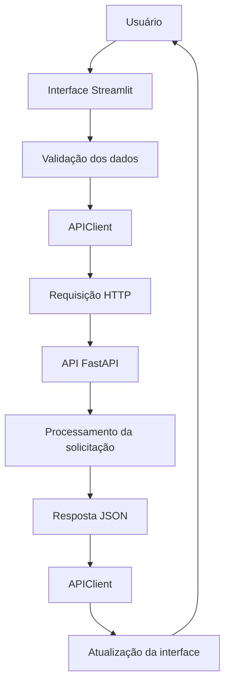

# Especificações do Frontend — DeliveryRisk AI

## 1. Visão geral

O frontend do **DeliveryRisk AI** foi desenvolvido utilizando Streamlit e tem como objetivo disponibilizar uma interface web para interação com o sistema de previsão de risco de atraso nas entregas de pedidos de e-commerce.

A interface permite que o usuário:

- Visualize informações gerais do sistema.
- Consulte indicadores e métricas do modelo.
- Informe os dados de um pedido para realizar uma previsão.
- Visualize a classificação e a probabilidade estimada de atraso.
- Consulte o histórico de previsões realizadas.
- Visualize os detalhes de uma previsão específica.
- Exclua registros do histórico.

O frontend foi desenvolvido como uma funcionalidade adicional ao escopo principal do projeto acadêmico.

## 2. Tecnologias utilizadas

| Tecnologia | Finalidade |
|---|---|
| Python | Linguagem de programação. |
| Streamlit | Construção da interface web. |
| Requests | Comunicação HTTP com a API. |
| Plotly | Construção de gráficos interativos. |
| Pandas | Organização e manipulação de dados apresentados na interface. |
| Pytest | Testes automatizados do frontend. |
| Streamlit AppTest | Testes das páginas Streamlit. |

## 3. Estrutura de diretórios

O frontend está organizado da seguinte maneira:

```text
frontend/
├── components/
│   ├── __init__.py
│   ├── charts.py
│   ├── metric_cards.py
│   ├── prediction_result.py
│   └── sidebar.py
│
├── pages/
│   ├── visao_Geral.py
│   ├── nova_Previsao.py
│   └── historico.py
│
├── utils/
│   ├── formatters.py
│   └── validators.py
│
├── api_client.py
├── config.py
└── streamlit_app.py
```

### 3.1. Arquivo principal

**`streamlit_app.py`**

Responsável pela inicialização da aplicação Streamlit.

Suas responsabilidades incluem:

- Configurar a página.
- Aplicar a identidade visual.
- Organizar a navegação.
- Integrar os componentes de interface.
- Disponibilizar o ponto de entrada da aplicação.

### 3.2. Configurações

**`config.py`**

Centraliza as configurações utilizadas pelo frontend.

Entre elas:

| Configuração | Descrição |
|---|---|
| `API_BASE_URL` | Endereço-base da API. |
| `APP_TITLE` | Título da aplicação. |
| `PAGE_ICON` | Ícone da aplicação. |
| `LAYOUT` | Configuração do layout da interface. |
| `MODEL_STATUS` | Informação de status apresentada pela interface. |

O endereço da API pode ser definido pela variável de ambiente `DELIVERYRISK_API_URL`.

Caso a variável não esteja configurada, o frontend utiliza:

```text
http://127.0.0.1:8000
```

### 3.3. Cliente da API

**`api_client.py`**

Centraliza toda a comunicação HTTP entre o frontend e o backend.

A classe `APIClient` disponibiliza os seguintes métodos:

| Método | Endpoint | Finalidade |
|---|---|---|
| `get_health()` | GET `/health` | Consultar a disponibilidade da API. |
| `predict()` | POST `/predict` | Solicitar uma nova previsão. |
| `get_predictions()` | GET `/predictions` | Consultar o histórico. |
| `get_prediction()` | GET `/predictions/{id}` | Consultar uma previsão específica. |
| `delete_prediction()` | DELETE `/predictions/{id}` | Excluir uma previsão. |
| `get_metrics()` | GET `/metrics` | Consultar as métricas do modelo. |

O cliente utiliza timeout de 10 segundos para as requisições HTTP.

Também centraliza o tratamento de erros de comunicação.

### 3.4. Componentes reutilizáveis

O diretório `components/` contém elementos compartilhados entre as páginas.

| Arquivo | Responsabilidade |
|---|---|
| `charts.py` | Construção dos gráficos utilizados na interface. |
| `metric_cards.py` | Apresentação de indicadores e métricas em cartões. |
| `prediction_result.py` | Apresentação do resultado de uma previsão. |
| `sidebar.py` | Elementos e informações da barra lateral. |

A utilização de componentes reutilizáveis evita duplicação de código e mantém a apresentação visual consistente.

### 3.5. Utilitários

O diretório `utils/` contém funções auxiliares.

| Arquivo | Responsabilidade |
|---|---|
| `formatters.py` | Formatação de números, percentuais, datas e outros valores apresentados na interface. |
| `validators.py` | Validação dos dados informados pelo usuário nos formulários. |

Essas funções auxiliam na preparação dos dados antes da comunicação com a API.

## 4. Navegação e páginas

O frontend possui três páginas principais.

### 4.1. Visão geral

Arquivo: `pages/visao_Geral.py`

A página de visão geral apresenta informações resumidas sobre o sistema e o desempenho do modelo.

**Funcionalidades:**

- Consultar a disponibilidade da API.
- Consultar as métricas do modelo.
- Apresentar indicadores relacionados às previsões.
- Exibir gráficos e visualizações.
- Apresentar informações gerais sobre o funcionamento do sistema.

**Fonte dos dados:**

As informações são obtidas por meio dos endpoints:

- `GET /health`
- `GET /metrics`
- `GET /predictions`

A página não realiza cálculos de previsão diretamente. Ela apresenta informações disponibilizadas pelo backend.

### 4.2. Nova previsão

Arquivo: `pages/nova_Previsao.py`

A página de nova previsão permite informar os atributos de um pedido e solicitar uma estimativa de risco de atraso.

**Funcionalidades:**

- Exibir formulário de entrada.
- Coletar as 24 features necessárias ao modelo.
- Validar os campos informados.
- Enviar os dados para a API.
- Apresentar o resultado da previsão.
- Exibir a classe prevista e a probabilidade estimada de atraso.
- Informar possíveis erros durante a operação.

**Endpoint utilizado:**

```http
POST /predict
```

**Fluxo de utilização:**

1. O usuário acessa a página.
2. Preenche os campos referentes ao pedido.
3. O frontend valida os dados.
4. O `APIClient` envia a requisição para o backend.
5. O backend executa o pipeline de Machine Learning.
6. O resultado é retornado em formato JSON.
7. O frontend apresenta o resultado ao usuário.

**Classificações possíveis:**

| Classe | Resultado |
|---|---|
| `0` | Sem atraso previsto |
| `1` | Atraso previsto |

A probabilidade apresentada corresponde à estimativa do modelo para a classe de atraso.

Essa probabilidade não representa uma garantia de que o pedido será entregue com atraso.

### 4.3. Histórico

Arquivo: `pages/historico.py`

A página de histórico permite consultar e gerenciar as previsões armazenadas pelo backend.

**Funcionalidades:**

- Consultar previsões registradas.
- Apresentar os registros em formato organizado.
- Consultar detalhes de uma previsão específica.
- Visualizar os dados de entrada e o resultado registrado.
- Excluir registros do histórico.

**Endpoints utilizados:**

```http
GET /predictions
GET /predictions/{id}
DELETE /predictions/{id}
```

O histórico é obtido exclusivamente pela API. O frontend não realiza consultas diretas ao SQLite.

## 5. Comunicação com o backend

A comunicação entre frontend e backend ocorre por meio de requisições HTTP utilizando JSON.

A arquitetura segue o seguinte fluxo:



### 5.1. Responsabilidades do frontend

O frontend é responsável por:

- Coletar informações do usuário.
- Validar os dados antes do envio.
- Formatar informações para apresentação.
- Realizar requisições HTTP.
- Interpretar respostas da API.
- Apresentar resultados e mensagens de erro.

### 5.2. Responsabilidades do backend

O backend é responsável por:

- Validar a estrutura das requisições.
- Executar o pipeline de Machine Learning.
- Aplicar as regras de negócio.
- Persistir as previsões.
- Consultar o histórico.
- Disponibilizar as métricas do modelo.

O frontend não importa o pipeline de Machine Learning e não acessa diretamente o banco de dados.

## 6. Validação dos dados

As validações da interface são realizadas por funções implementadas em `utils/validators.py`.

O objetivo é reduzir o envio de dados inválidos à API e fornecer mensagens claras ao usuário.

As validações contemplam os tipos e limites esperados para os atributos do modelo.

Entre os exemplos estão:

- Quantidades inteiras positivas.
- Valores monetários e medidas não negativos.
- Mês entre 1 e 12.
- Dia do mês entre 1 e 31.
- Dia da semana entre 0 e 6.
- Hora entre 0 e 23.
- Estado com duas letras maiúsculas.
- Campos textuais com limites de comprimento.
- Valores booleanos para a indicação de compra em fim de semana.

A API também realiza suas próprias validações utilizando Pydantic. Portanto, a validação do frontend não substitui a validação do backend.

## 7. Tratamento de erros

O tratamento de erros de comunicação está centralizado em `api_client.py`.

A exceção `APIClientError` é utilizada para encapsular problemas encontrados durante as requisições.

O cliente trata as seguintes situações:

| Situação | Tratamento |
|---|---|
| Timeout | Identificação de demora excessiva na resposta. |
| Falha de conexão | Identificação de indisponibilidade ou impossibilidade de conexão com a API. |
| Erro HTTP | Tratamento de respostas com status de erro. |
| JSON inválido | Identificação de resposta fora do formato esperado. |
| Resposta HTTP 204 | Tratamento de operação concluída sem conteúdo de resposta. |
| Erros de requisição | Captura de exceções da biblioteca Requests. |

As páginas utilizam essas informações para apresentar mensagens apropriadas ao usuário, evitando que falhas de comunicação interrompam inesperadamente a interface.

## 8. Configuração e execução

O frontend deve ser executado com o backend ativo, pois depende da API para consultar métricas, realizar previsões e acessar o histórico.

### 8.1. Pré-requisitos

- Python instalado.
- Ambiente virtual configurado.
- Dependências do projeto instaladas.
- Backend FastAPI disponível.

### 8.2. Inicialização do backend

No primeiro terminal, a partir da raiz do projeto:

```powershell
.venv\Scripts\Activate.ps1
uvicorn backend.main:app --reload
```

A API estará disponível em:

```text
http://127.0.0.1:8000
```

Documentação interativa:

```text
http://127.0.0.1:8000/docs
```

### 8.3. Inicialização do frontend

No segundo terminal, a partir da raiz do projeto:

```powershell
.venv\Scripts\Activate.ps1
$env:PYTHONPATH = "$PWD\frontend;$PWD"
streamlit run frontend/streamlit_app.py
```

A interface estará disponível em:

```text
http://localhost:8501
```

### 8.4. Configuração personalizada da API

Para utilizar outro endereço de API, defina a variável de ambiente:

```powershell
$env:DELIVERYRISK_API_URL = "http://127.0.0.1:8000"
```

O valor configurado deve corresponder ao endereço em que o backend está sendo executado.

## 9. Testes do frontend

Os testes automatizados do frontend estão localizados em `tests/tests_frontend/`.

A estrutura contempla:

```text
tests/tests_frontend/
├── integration/
│   ├── test_api_integration.py
│   └── test_frontend_pages.py
│
└── unit/
    ├── test_api_client.py
    ├── test_formatters.py
    └── test_validators.py
```

### 9.1. Testes unitários

Verificam individualmente:

- Métodos do cliente HTTP.
- Tratamento de erros.
- Formatação de valores.
- Validação dos campos de entrada.

### 9.2. Testes de integração

Verificam:

- Comunicação entre frontend e API.
- Comportamento das páginas Streamlit.
- Integração entre os componentes da interface e o cliente HTTP.

O Streamlit AppTest é utilizado para testar o comportamento das páginas sem depender de uma interação manual pelo navegador.

### 9.3. Execução dos testes

Para executar toda a suíte de testes:

```bash
python -m pytest tests/ -v
```

Na execução registrada durante o desenvolvimento, foram aprovados 91 testes automatizados no projeto, contemplando backend e frontend.

## 10. Requisitos não funcionais

### 10.1. Usabilidade

A interface foi organizada em páginas independentes, permitindo que o usuário encontre as principais funcionalidades sem precisar interagir diretamente com a API.

### 10.2. Manutenibilidade

A separação entre páginas, componentes, utilitários e cliente HTTP facilita a manutenção e a evolução do frontend.

### 10.3. Reutilização

Componentes e funções auxiliares são compartilhados entre as páginas, reduzindo duplicações.

### 10.4. Comunicação desacoplada

A comunicação com o backend é centralizada em `APIClient`, evitando requisições HTTP implementadas individualmente em diferentes partes da interface.

### 10.5. Tratamento de falhas

O frontend possui tratamento para erros de comunicação e respostas inesperadas da API, permitindo apresentar mensagens apropriadas ao usuário.

## 11. Limitações e considerações

O frontend foi desenvolvido como parte complementar do projeto acadêmico DeliveryRisk AI.

Algumas considerações importantes:

- A interface depende da disponibilidade do backend FastAPI.
- O frontend não realiza treinamento ou avaliação de modelos.
- As previsões são executadas exclusivamente pelo backend.
- O histórico depende da persistência implementada no SQLite.
- As métricas apresentadas são obtidas dos dados disponibilizados pela API.
- A interface não substitui a documentação técnica da API.
- Os resultados apresentados dependem do desempenho e das limitações do modelo treinado.

O modelo possui limitações de generalização identificadas durante a avaliação temporal. Portanto, as classificações e probabilidades devem ser interpretadas como estimativas experimentais.

A aplicação foi desenvolvida para demonstração e avaliação acadêmica, não sendo considerada uma solução homologada para operação em produção.

## 12. Resumo

O frontend do DeliveryRisk AI utiliza Streamlit para disponibilizar uma interface web organizada em três páginas principais: Visão geral, Nova previsão e Histórico.

Sua arquitetura separa a apresentação, os componentes reutilizáveis, as funções auxiliares e a comunicação HTTP.

A integração com o backend ocorre exclusivamente por meio da classe `APIClient`, garantindo que o frontend não acesse diretamente o pipeline de Machine Learning ou o banco de dados SQLite.

Essa organização facilita a manutenção, a reutilização de componentes e a integração entre as diferentes partes do sistema.